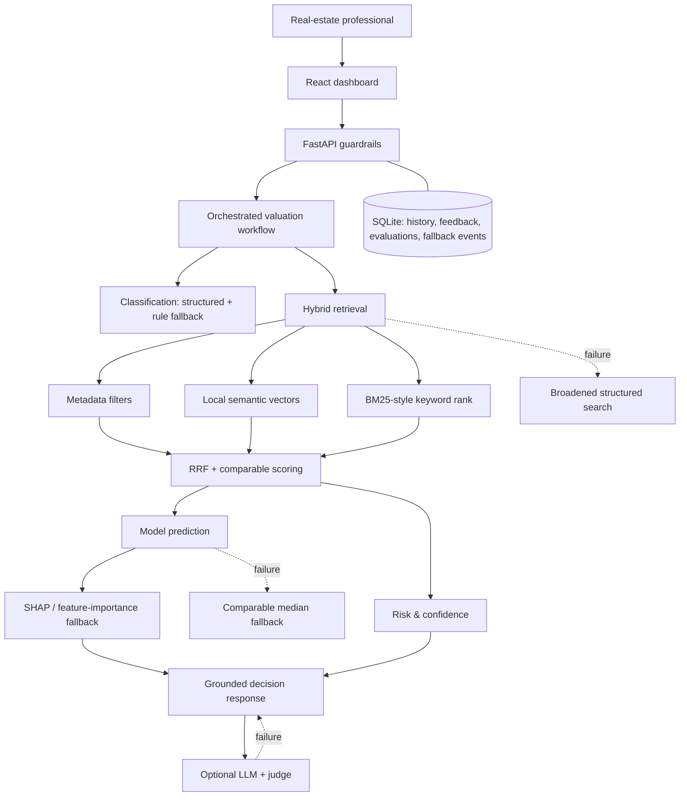

# Architecture and decisions

The app deliberately uses local SQLite and local retrieval so it stays usable without cloud services. LLM and Chroma enhancements are optional; their absence is disclosed rather than hidden. The active implementation performs deterministic orchestration with independently recoverable classification, retrieval, prediction, risk, and explanation stages; LangGraph can be added as an execution backend when installed without changing state boundaries.
